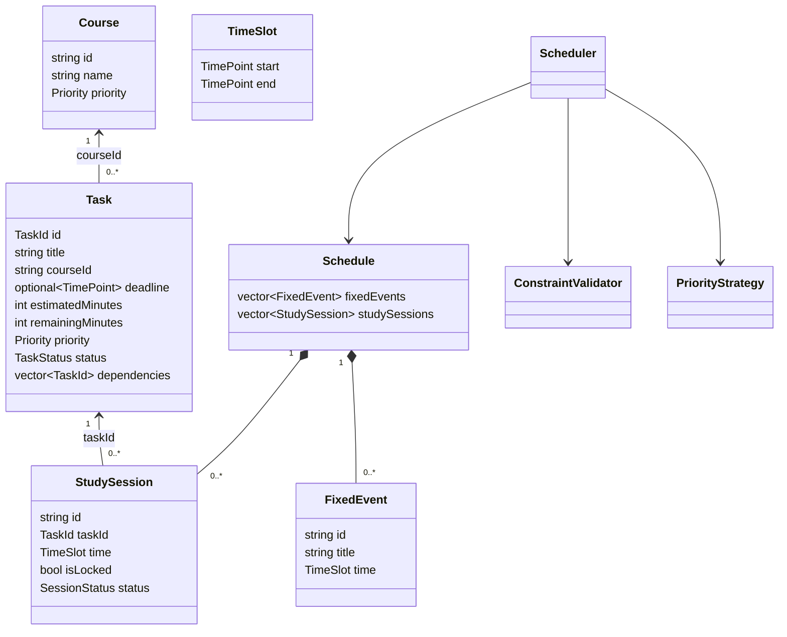
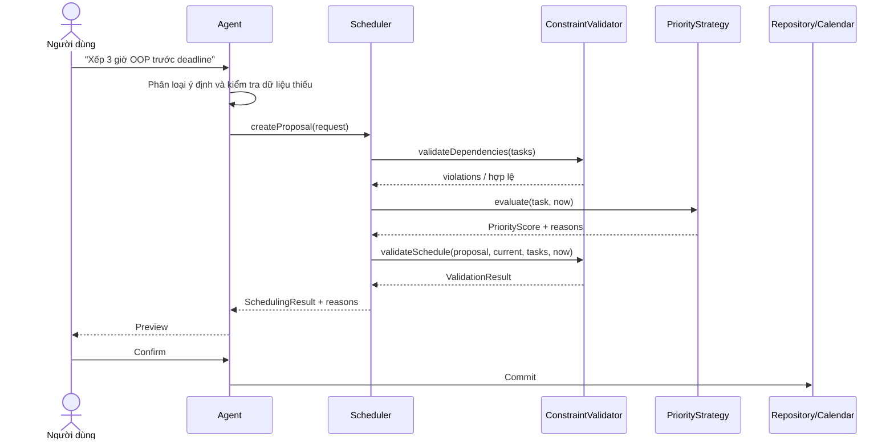

# EduSchedule-Agent - Giải thích khung sườn header

> Cập nhật: 20/10/2026  
> Phạm vi: các header do Trần Hồng Anh và Trương Hoàng Huy phụ trách trong
> `src/`. Tài liệu này mô tả **hợp đồng tích hợp đã chốt**, không tuyên bố
> những thuật toán chưa được triển khai.

## 1. Mục đích của lần chốt header

Các module được thống nhất để thành viên có thể làm độc lập mà không tự đặt lại
kiểu dữ liệu hoặc chữ ký hàm:

- Tất cả lớp/kiểu nghiệp vụ dùng namespace `edu_schedule`.
- `TimePoint` và `TaskId` chỉ định nghĩa một lần trong
  `src/models/domain_types.h`.
- `Task`, `FixedEvent` và `StudySession` là ba khái niệm khác nhau.
- Scheduler tạo **proposal**, không tự ghi dữ liệu.
- Hard constraints luôn được kiểm tra trước soft constraints.
- Tool phải đi qua `ToolRegistry`; Tool mới mặc định không được phép chạy.
- Mọi thay đổi lịch tuân thủ **Preview -> Confirm -> Commit**.

## 2. Toàn cảnh hệ thống

```mermaid
flowchart LR
    U[Người dùng] --> A[Agent / Intent Classification]
    A -->|Khai báo Task hoặc deadline| R[Task Repository]
    A -->|Yêu cầu xếp hoặc phục hồi lịch| SR[SchedulingRequest / RecoveryRequest]
    A -->|Gọi công cụ| TR[ToolRegistry]
    TR --> IT[ITool]
    IT --> TL[TaskLookupTool]
    SL[SkillLoader] -. nạp hướng dẫn .md .-> A

    SR --> S[Scheduler]
    S --> CV[ConstraintValidator]
    S --> PS[PriorityStrategy]
    CV -->|Loại phương án sai| S
    PS -->|Xếp hạng phương án hợp lệ| S
    S --> RES[SchedulingResult + reasons]
    RES --> P[Preview]
    P --> C{Người dùng xác nhận?}
    C -->|Có| COMMIT[Commit qua tầng Repository/Calendar]
    C -->|Không| STOP[Giữ dữ liệu hiện tại]
```

Điểm quan trọng: câu “Tôi phải nộp bài OOP vào tối mai” chỉ tạo/cập nhật
`Task.deadline`. Scheduler chỉ chạy khi người dùng yêu cầu xếp lịch, chẳng hạn
“Hãy xếp cho tôi 3 giờ học OOP trước deadline”.

## 3. Quan hệ dữ liệu



`deadline` là một **mốc thời gian**, không phải khoảng bận. `FixedEvent` là
khoảng bận cố định. `StudySession` là phiên học gắn với một `Task`.

## 4. Giải thích từng header

### Nhóm kiểu dữ liệu nền tảng

#### `src/models/domain_types.h`

Nơi định nghĩa duy nhất:

- `TimePoint = std::chrono::system_clock::time_point`
- `TaskId = std::string`

`TimePoint` biểu diễn mốc tuyệt đối. Việc đọc/hiển thị giờ Việt Nam hoặc múi
giờ khác thuộc tầng nhập/xuất; không lưu chuỗi giờ địa phương thay cho
`TimePoint`.

#### `src/models/priority.h`

Định nghĩa `Priority::{Low, Mid, High}`. Priority là dữ liệu cho heuristic;
`High` không cho phép Scheduler xếp đè FixedEvent, vượt deadline hoặc phá bất
kỳ hard constraint nào.

Tên file là `priority.h` chữ thường. Include sai thành `Priority.h` có thể
chạy trên Windows nhưng hỏng trên Linux.

#### `src/models/TaskStatus.h`

Định nghĩa trạng thái của Task: `Todo`, `InProgress`, `Done`, `Blocked`,
`Cancelled`. Đây không phải trạng thái của phiên học.

Task quá hạn được suy ra bằng `Task::isOverdue(now)`; không thêm `Overdue`
vào enum vì một Task vẫn cần giữ trạng thái công việc hiện tại.

#### `src/models/Task.h`

`Task` là công việc cần hoàn thành:

- `deadline`: mốc cuối, có thể không có.
- `estimatedMinutes`: tổng thời lượng dự kiến; 0 nghĩa là chưa biết.
- `remainingMinutes`: phần còn lại cần xếp.
- `dependencies`: danh sách ID Task phải hoàn thành trước.

Các bất biến cần validator/repository kiểm tra:

- ID không rỗng và không trùng.
- `0 <= remainingMinutes <= estimatedMinutes` khi đã biết thời lượng.
- Dependency tồn tại, không tự trỏ và không tạo chu trình.
- Không tự sinh dependency hoặc StudySession chỉ từ một câu khai báo deadline.

#### `src/models/Course.h`

`Course` gom Task theo môn/chủ đề. Task tham chiếu Course qua `courseId`;
Course không sở hữu trực tiếp danh sách Task. Priority của Course là gợi ý mặc
định, không tự ghi đè priority mà người dùng đã đặt trên Task.

### Nhóm dữ liệu lịch

#### `src/tools/Task_domain.h`

Header này chứa các kiểu dùng chung cho Scheduler và Tool:

- `TimeSlot`: khoảng nửa mở `[start, end)`, bắt buộc `start < end`.
- `FixedEvent`: sự kiện cố định, Scheduler không được tự thay đổi.
- `StudySession`: phiên học có `taskId`, thời gian, khóa và trạng thái.
- `Schedule`: tập FixedEvent và StudySession.
- `SchedulingResult`: proposal, trạng thái và lý do.

Hai khoảng 09:00-10:00 và 10:00-11:00 không chồng lấn. Hai phiên có cùng ID chỉ
được coi là cùng một phiên sau khi validator đã xác nhận ID hợp lệ và duy nhất.

`Scheduled` không có nghĩa là đã lưu. Mọi trạng thái proposal vẫn cần người
dùng xem và xác nhận trước khi commit.

### Nhóm Tool và Skill

#### `src/agent/Tool.h`

`ITool` là giao diện chung:

```cpp
virtual std::string_view name() const noexcept = 0;
virtual std::string_view description() const noexcept = 0;
virtual ToolResult execute(std::string_view input) = 0;
```

`name()` phải ổn định và duy nhất. Hai `string_view` không được trỏ tới chuỗi
cục bộ đã bị hủy. Lỗi nghiệp vụ trả `ToolResult{false, message}`.

#### `src/agent/ToolRegistry.h`

Registry sở hữu Tool bằng `std::unique_ptr`, chống tên trùng và cung cấp hai
overload `findTool()` đúng const-correctness:

- đối tượng thường trả `ITool*`;
- đối tượng const trả `const ITool*`.

Tool mới có `ToolAccess::Denied`. Chỉ tầng cấu hình tin cậy được gọi
`setToolAccess(..., Allowed)`. Agent phải gọi `ToolRegistry::execute()` thay
vì lấy con trỏ rồi gọi trực tiếp, vì `execute()` mới kiểm tra quyền và đóng gói
exception thành `ToolResult`.

```cpp
ToolRegistry registry;
registry.registerTool(std::make_unique<MyTool>()); // mặc định Denied
registry.setToolAccess("my_tool", ToolAccess::Allowed);
ToolResult result = registry.execute("my_tool", input);
```

Allow Tool không đồng nghĩa người dùng đã xác nhận ghi lịch.

#### `src/tools/TaskLookupTool.h`

Tool mẫu chỉ đọc một Task được mượn qua constructor. Input hiện là ID thuần như
`"T1"`, chưa phải JSON. Task phải sống lâu hơn Tool.

Header đã sửa để thực sự triển khai `ITool`: tên/mô tả trả `string_view`, còn
`execute()` trả `ToolResult`.

#### `src/agent/SkillLoader.h`

`SkillLoader` chốt giao diện đọc một hoặc nhiều file Markdown. Skill là nội
dung hướng dẫn, không phải Tool, không được tự thực thi lệnh và không tự cấp
quyền cho Tool.

Khi triển khai phải chặn `..`, đường dẫn tuyệt đối và symlink thoát khỏi
`skillDirectory`. Hiện header đã chốt nhưng phần đọc file chưa được viết.

### Nhóm Scheduler của Trương Hoàng Huy

#### `src/scheduler/priority_strategy.h`

`PriorityStrategy` là Strategy Pattern: Scheduler phụ thuộc abstraction, không
gắn cứng vào một công thức. `UrgencySlackPriorityStrategy` sẽ chấm theo:

- importance: Priority người dùng đặt;
- urgency: khoảng cách tới deadline;
- slack cơ bản: `deadline - now - remainingMinutes`.

Slack này chỉ là heuristic vì chưa trừ các khoảng bận. Strategy chỉ xếp hạng Task
đã hợp lệ; không được bỏ qua validator.

#### `src/scheduler/constraint_validator.h`

`ConstraintValidator` chỉ xử lý hard constraints:

- thời gian hợp lệ;
- không chồng FixedEvent/StudySession đang chiếm chỗ;
- phiên mới không nằm trong quá khứ;
- kết thúc không sau deadline khi tuyên bố hoàn thành đúng hạn;
- mặc định học trong 08:00-22:00 UTC+07;
- dependency tồn tại, đúng thứ tự và không có chu trình;
- FixedEvent và StudySession khóa không bị sửa.

`validateSchedule()` nhận cả proposal và lịch hiện tại để không nhầm dữ liệu
lịch sử với phiên mới. Validator không chấm điểm và không thay đổi dữ liệu.

#### `src/scheduler/scheduler.h`

`Scheduler` phối hợp Validator và PriorityStrategy. Hai API chính:

- `createProposal()`: tạo lịch nháp từ Task và lịch hiện tại.
- `createRecoveryProposal()`: tạo phiên bù tương lai cho phiên đã `Missed`.

`planningEnd` tạo phạm vi hữu hạn `[now, planningEnd)`, cần thiết khi Task
không có deadline. Nó không biến thành deadline của Task.

Scheduler phải xếp `remainingMinutes`, tránh tính lại phần đã nằm trong phiên
`Planned`, bảo vệ dữ liệu gốc và trả lý do khi chỉ xếp được một phần hoặc không
xếp được.

## 5. Luồng tạo proposal



## 6. Trạng thái triển khai tại thời điểm chốt

| Thành phần | Trạng thái |
|---|---|
| Các model và helper nhỏ trong header | Có cấu trúc/invariant; một số helper inline hoạt động |
| `ITool`, `ToolRegistry` | Giao diện và logic registry nằm trong header |
| `TaskLookupTool.h` | Giao diện đã chốt |
| `SkillLoader.h` | Chỉ chốt giao diện |
| Ba header Scheduler | Chỉ chốt giao diện và kiểu đầu vào/đầu ra |
| Thuật toán xếp lịch/validator/priority | Chưa có file triển khai |
| Preview/Confirm/Commit thực tế | Chưa nối với Repository/Calendar |

Không báo cáo rằng Scheduler, SkillLoader hoặc luồng end-to-end đã chạy hoàn
chỉnh chỉ vì header biên dịch được.

## 7. Xung đột và việc cần phối hợp với thành viên khác

### Cần Hồng Anh cập nhật phần triển khai

`src/tools/TaskLookupTool.cpp` hiện dùng namespace global và chữ ký cũ
(`std::string`). File này phải được đổi sang `namespace edu_schedule`, dùng
thành viên `task_`, và triển khai đúng:

```cpp
std::string_view name() const noexcept;
std::string_view description() const noexcept;
ToolResult execute(std::string_view input);
```

`src/agent/SkillLoader.cpp` đang rỗng. Khi triển khai phải đặt định nghĩa trong
`namespace edu_schedule` và tuân thủ quy tắc chống path traversal đã ghi trong
header.

### Cần Nam cập nhật AgentLoop

`include/agent/agent_loop.h` đang mô phỏng gọi Tool bằng cách trả chuỗi “đã
chạy”, chưa gọi `ToolRegistry::execute()`. Parser hiện đặt arguments thành
`"{}"`, nên chưa truyền được TaskId cho `TaskLookupTool`.

Khi tích hợp cần:

1. Inject `ToolRegistry` vào AgentLoop.
2. Parse tên Tool và arguments theo schema rõ ràng.
3. Gọi `registry.execute(name, arguments)`.
4. Không coi allowlist là xác nhận ghi dữ liệu.

Không sửa file AgentLoop trong lần chốt header này.

### Cần người phụ trách CMake/test cập nhật build

`CMakeLists.txt` hiện chỉ build `main.cpp` và `ollama_client.cpp`, nên có thể
báo build xanh dù Tool/Scheduler bị lỗi. Cần thêm target kiểm tra header, build
các `.cpp` mới và chạy test contract. Không sửa CMake trong lần này.

Dự án đang đặt C++23, phù hợp với `std::span`. Máy/CI phải dùng cấu hình
C++20 trở lên; nếu VS Code hiện lỗi `std::span`, kiểm tra IntelliSense trước khi
sửa API.

### Cần Ân phối hợp ở Repository/SQLite/ICS

- Lưu đúng `TaskId`, `TimePoint`, trạng thái Task và Session.
- Chuyển múi giờ tại biên nhập/xuất; không đổi `TimePoint` thành chuỗi nội bộ.
- Chỉ commit proposal sau confirm.
- Xuất lịch phải qua Validator; giữ nguyên FixedEvent và phiên khóa.

### Quy ước chung cho cả nhóm

- Include đúng hoa/thường, đặc biệt `models/priority.h`.
- Không định nghĩa thêm `TimePoint` hoặc tạo namespace `edu`.
- Không đổi interface dùng chung mà chưa báo các module phụ thuộc.
- Nếu thêm Tool ghi dữ liệu, phải vừa qua Tool policy vừa qua
  Preview -> Confirm -> Commit.
- Test tối thiểu phải có: ID trùng, chu trình dependency, overlap, deadline đã
  qua, không đủ slot, phiên khóa, Tool mặc định Denied và recovery không làm mất
  lịch cũ.

## 8. Checklist trước khi merge phần header

- [ ] Tất cả header dùng `namespace edu_schedule`.
- [ ] Không còn include `Priority.h` sai hoa/thường.
- [ ] `TimePoint` chỉ xuất hiện dưới dạng định nghĩa tại `domain_types.h`.
- [ ] Mỗi header tự include đủ dependency và biên dịch độc lập.
- [ ] `TaskLookupTool.cpp` được cập nhật theo header.
- [ ] AgentLoop thực thi Tool qua Registry.
- [ ] CMake/CI thực sự compile module Tool và Scheduler.
- [ ] Thuật toán mới có unit test trước khi tuyên bố hoàn thành.

## 9. Kết quả kiểm tra tại thời điểm viết tài liệu

- 13 header trong phạm vi chốt đã biên dịch độc lập bằng GCC 15.2, C++23,
  `-Wall -Wextra -Wpedantic -Werror`.
- Contract compile-time đã xác nhận `ITool`, hai overload `findTool()`,
  `std::span<const Task>` và chữ ký Validator/Scheduler.
- Kiểm tra runtime phần header-only đã xác nhận Tool mặc định Denied, Tool được
  phép mới chạy, exception được đóng gói, khoảng chạm biên không overlap và
  helper quá hạn hoạt động.
- `TaskLookupTool.cpp` hiện **chưa biên dịch với header mới**, đúng với xung đột
  đã nêu ở mục 7. Cần cập nhật file này trước khi đưa nó vào target build.
- Không sửa `CMakeLists.txt`, `include/`, `main.cpp` hoặc file của Nam/Ân
  trong lần chốt này.
